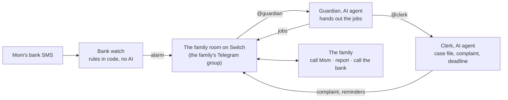

# Parent Line

**When an older parent's bank SMS looks like a scam, the family's group chat gets an alarm, and two AI agents help the family act on it together. Built on [Switch](https://github.com/sandbox-quantum/switch).**

**[Demo video](https://youtu.be/VWSH7CKUek0)** · **[Website](https://web-jet-three-69.vercel.app/)** · **[Try it in one minute](#run-it)** · **[How Switch is used](#how-switch-is-used)** · **[My pull requests to Switch](#my-pull-requests-to-switch)**

Digital-arrest scammers win by isolation. They keep an older parent on a video call for hours, forbid them to tell anyone, and walk them through sending their savings to "clear their name". The bank's confirmation call doesn't help: it reaches the one person the scammer controls, who has been told what to say.

Parent Line tells the family instead. Someone calls the parent, someone reports it, someone calls the bank, and the paperwork is done before the bank's reporting deadline.

## For judges

| You're judging | Where to look |
|---|---|
| **Use of Switch** | [How Switch is used](#how-switch-is-used): a Telegram room shared by people, two Claude Code agents and three services with no AI; agent-to-agent handoff, room instructions, room documents, the agent API and event stream. Plus [four pull requests to Switch](#my-pull-requests-to-switch) |
| **Can it be reproduced** | [Run it](#run-it): `python3 check.py` in one minute with no Switch, then about 20 minutes to the full flow on Telegram |
| **Impact** | [The problem](#the-problem): 21,900+ complaints and ₹647 crore+ in eight months of 2026, and why the bank's own check can't stop it |
| **Presentation** | The [demo video](https://youtu.be/VWSH7CKUek0), the [website](https://web-jet-three-69.vercel.app/), and [what the family sees](#what-the-family-sees) |

[AGENTS.md](AGENTS.md) has the whole project in one file, for AI assistants and anyone who prefers that.

## The problem

- **It is large.** The Ministry of Home Affairs told the Supreme Court of **21,900+ digital-arrest complaints involving ₹647 crore+** from January to August 2026. Complaints are falling, from 1.24 lakh in 2024 to 58,239 in 2025, but the numbers are still big. ([Hindustan Times, 23 Oct 2026](https://www.hindustantimes.com/india-news/21900-digital-arrest-complaints-registered-till-sept-mha-to-sc-101792697131006.html))
- **It works through isolation.** Victims are kept on video calls "for hours or even days" and told they "must not communicate with anyone else". ([Indian Express, 30 Oct 2026](https://indianexpress.com/article/explained/digital-arrest-scams-supreme-court-rbi-bank-liability-explained-10943089/))
- **It targets the elderly, and the official fix looks like ours.** The NHRC says cybercrimes "mostly affect elderly persons" and recommends "trusted-person authentication" alerts. ([PIB, 9 Jun 2026](https://www.pib.gov.in/PressReleasePage.aspx?PRID=2270875&lang=1&reg=3))
- **Family members stop these scams.** A daughter in Lucknow saved her 86-year-old father ₹60 lakh ([Amar Ujala](https://www.amarujala.com/lucknow/up-digital-arrest-daughter-saves-86-year-old-father-from-being-duped-2026-04-22)). A daughter in Rajkot stopped ₹41 lakh more from leaving her parents' account ([India Today](https://www.indiatoday.in/cities/other-cities/story/digital-arrest-scam-rajkot-elderly-couple-duped-rs-55-5-lakh-fake-mumbai-crime-branch-officers-2981908-2026-08-28)). An 8-year-old in Bareilly ended a 10-hour scam call on his parents ([India Today](https://www.indiatoday.in/india/story/digital-arrest-cyber-scam-bareilly-8-year-old-boy-saves-parents-2894121-2026-04-10)). These are single stories; we found no study measuring how often family help stops these scams.

## How it works



1. **Bank watch reads the parent's bank SMS** and fires on scam patterns: a large debit, a new payee, an FD broken early, a loan, several debits close together, a debit late at night. The rules are plain, tested code, not an AI's judgement. Ordinary spending goes nowhere.
2. **The alarm lands in the family's Telegram group**, addressed to the Guardian. The parent never has to spot the scam themselves.
3. **The Guardian splits the response into three jobs**: call the parent on a normal call (which breaks the video call's hold), report on 1930 or cybercrime.gov.in, and call the bank. It tracks who took each job, chases the ones nobody took, and closes the alarm when the parent is safe.
4. **The Clerk does the paperwork.** The Guardian hands it the case. It keeps a case file, writes the 1930 complaint and the letter to the bank, and tracks RBI's reporting deadline: 3 working days for an unauthorised debit, with a reminder on the last day. When a bank, ride app or railway doesn't answer, it drafts a post on X with no names, phone numbers or account numbers, and a family member reads it and presses Post themselves. No agent publishes anything.

The same room takes two more kinds of alarm:

- **Ride watch**, a check-in for a ride alone at night. Before an Ola, Uber, Rapido or auto ride, write `@ride-watch 25 min` and paste the app's share-trip message. With no `reached` 10 minutes after that, it asks; with no answer 5 minutes later, the family gets an alarm with the vehicle and driver details and three jobs: call them, check the trip link, call 112. A code word raises it at once. Nobody is tracked unless they start a ride.
- **Call watch**, a missed-call SOS. The parent gives "Family SOS" a missed call when a caller scares them; Call watch rejects it, so it costs nothing, and asks the group who is calling Mom back. One tap on a number they already know works for a parent who can't type or use an app.

**Optional: Line**, a help line in the parent's WhatsApp or SMS chat that helps with phone questions one step at a time, in Hindi, English or Hinglish. When a request is really a scam ("install AnyDesk", "tell me the OTP") it refuses and alerts the family. It needs Switch's WhatsApp or SMS adapter, both [my open pull requests](#my-pull-requests-to-switch); everything else runs on Switch as released.

The full design is in [docs/design.md](docs/design.md).

## What the family sees

Bank watch posts:

> 🚨 **Bank alarm: Mom** · 23:40
> **₹4,80,000** left the account to **RAKESH KUMAR**.
>
> **Why it looks wrong**
> • Over the ₹50,000 limit
> • Sent to a payee never paid before
> • Late at night (23:40)
>
> **Bank SMS**
> _Dear Customer, A/C X1234 debited by Rs.480000.00 on date 06Nov26 by IMPS to RAKESH KUMAR Ref 431234567890. If not u? call 1800111109. -SBI_
>
> **Report to the bank by Tue 10 Nov.** If Mom didn't make this payment, reporting by then means Mom shouldn't bear the loss (RBI rules).
>
> @guardian over to you.

The Guardian answers within seconds:

> 🚨 **₹4,80,000 left Mom's SBI account at 23:40**
> To RAKESH KUMAR · ref 431234567890
> Looks like a digital-arrest scam: big amount, new payee, late at night.
>
> 1. **Call Mom now**, normal call, not WhatsApp
> 2. **Report** on 1930 or cybercrime.gov.in
> 3. **Call SBI** on 1800 111 109 (from their SMS)
>
> Reply @guardian with the number of the job you're taking.
> **Report to SBI by Tue 10 Nov.**

Then, as the family replies:

> 1 ⏳ Riya calling Mom
> 2 ❌ nobody yet
> 3 ✅ Arjun, SBI blocked transfers
> Arjun, can you take 2? @clerk is writing the complaint.

The Clerk opens the case file and writes the complaint, ready to paste:

> 📁 Case file opened: case-2026-11-06-sbi-480000

**In a live test on Telegram**, the Guardian answered 5 seconds after the alarm and the Clerk updated the case file 28 seconds after it. With no job taken, the Guardian chased the family at 3 minutes ("Call Mom first"). A reply of `@guardian I'll take 1` got the updated job list 2 seconds later.

<details>
<summary>The deadline reminder Bank watch posts on the last day</summary>

> ⏰ **Report Mom's debit to the bank by Tue 10 Nov**
> ₹4,80,000 to RAKESH KUMAR at 23:40 on Fri 6 Nov
> If Mom didn't make this payment, reporting it by then means Mom shouldn't bear the loss (RBI rules).
> If they were tricked into paying, report anyway: fast reports are how money gets frozen.
>
> @clerk has it been reported? Post the bank's complaint number.

</details>

## How Switch is used

Switch connects every part. Without it, nothing reaches anyone. The family's Telegram group is a Switch room, and everything in Parent Line, people, AI agents and plain-code services alike, works by posting to that room and being addressed in it.

| Part | What it is | The Switch features it uses |
|---|---|---|
| **The family group** | People, in a Telegram group | The **Telegram bridge** makes the group a Switch room |
| **Guardian** | AI agent (Claude Code, started by Switch Console) | The room's **assigned agent**; its behaviour is the **room's instructions**, set by `bankwatch setup` through `update_room` |
| **Clerk** | AI agent (Claude Code) | **Agent-to-agent handoff** (`@clerk please open a case`); the case file is a **room document** (`create_room_document`); API posts wait for Switch's **approval card** |
| **Bank watch** | Python service, no AI | Its own **agent identity**; posts alarms through the **agent API** (`POST /agents/{id}/message`), and Switch delivers its **@-mention** to the Guardian |
| **Ride watch** | Python service, no AI | Reads its messages from the **agent event stream** (`GET /agents/{id}/events`); passes screenshots on as **Switch media ids** for the Guardian's `download_attachment` |
| **Call watch** | Python service, no AI | A Twilio webhook in, the **agent API** out |
| **Line** (optional) | AI agent | The **WhatsApp or SMS adapter** (my pull requests) makes the parent's chat a room; it hops to the family room with `connect_to_room` |

**Why three services have no AI:** whether to wake a family about money has to be predictable and testable, so it is a rule in code. AI agents also can't keep a clock, so Ride watch keeps the time and the Guardian only acts when addressed.

<details>
<summary>Each part in detail</summary>

| Part | What it is | How it uses Switch |
|---|---|---|
| **Family group** | A Telegram group | Switch's Telegram bridge makes it a Switch room. Family messages reach the Guardian, and its replies appear in Telegram. |
| **Guardian** | An AI agent (Claude Code, started by Switch Console) | Connected to the family room as its assigned agent. Its behaviour is the room's instructions: [guardian/family-room-instructions.md](guardian/family-room-instructions.md). |
| **Clerk** | An AI agent (Claude Code), working in [clerk/](clerk/) | In the family room beside the Guardian. The Guardian hands it the case (`@clerk please open a case`), an agent-to-agent handoff through Switch. It keeps the case file as a Switch room document (`create_room_document`). Its public posts run `clerk/xpost.py intent`, which checks the draft and prints an X link with the text filled in; the Clerk sends it in the family's chat and a person presses Post. The optional `xpost.py post` publishes through the X API instead, and [clerk/.claude/settings.json](clerk/.claude/settings.json) makes that wait for Switch's approval card. |
| **Bank watch** | A small Python service: [bankwatch/](bankwatch/) | A Switch agent identity with no AI session. When a rule fires, it posts the alarm into the family room through Switch's agent API (`POST /agents/{id}/message`) and @-mentions the Guardian, and Switch delivers that mention. It also reminds the Clerk on the last day to report a debit to the bank. `setup` uses its agent key to set the room's instructions (`update_room`). |
| **Ride watch** | A small Python service: [ridewatch/](ridewatch/) | Another Switch agent identity with no AI session. It reads the messages addressed to it through Switch's agent event stream (`GET /agents/{id}/events`, a long poll), keeps the clock that the AI agents can't, and posts the check-in and the alarm through the same API as Bank watch. It never reads a screenshot: it keeps the image's Switch media id and lists it in the alarm, and the Guardian, which is Claude, downloads it with its Switch `download_attachment` tool and reads it. The alarm @-mentions the Guardian. |
| **Call watch** | A small Python service: [callwatch/](callwatch/) | A third Switch agent identity with no AI session. Twilio sends each call to the family's number to it; it checks Twilio's signature and the caller's number, rejects the call, and posts the 📞 SOS into the family room through Switch's agent API, @-mentioning the Guardian. |
| **Line** (optional) | The parent's help line: an AI agent in their WhatsApp or SMS chat | Switch's WhatsApp or SMS bridge makes the chat a room. Line helps the parent there, then hops to the family room (`connect_to_room`) to post a help case or raise an alarm. Its behaviour is the room's instructions: [guardian/line-instructions.md](guardian/line-instructions.md). Those adapters are open pull requests to Switch; see the optional extras under [Run it](#run-it). |

</details>

## Run it

**One minute, no Switch needed.** With Python 3.11 or newer and nothing else installed:

```bash
git clone https://github.com/prx-my/parent-line && cd parent-line
python3 check.py
```

`check.py` checks your Python version and creates `family.toml` from the example. It then runs the tests and confirms that a sample scam SMS raises the alarm. Each line it prints reads `OK`, `NOTE` or `FAIL`, and every `FAIL` comes with the fix. It also lists which tools the later steps need. To see the alarm the family group would get:

```bash
python3 -m bankwatch simulate "Dear Customer, A/C X1234 debited by Rs.480000.00 on date 06Nov26 by IMPS to RAKESH KUMAR Ref 431234567890. If not u? call 1800111109. -SBI" --at 23:40 --dry-run
```

A dry run posts nothing and records nothing, so you can repeat it.

**The full flow on Telegram, about 20 minutes.** You need no phone and no bank: one Telegram group and a simulated bank SMS show the whole alarm. You need:

- Python 3.11 or newer (`python3 --version`). Bank watch has no other dependencies.
- [Switch Console](https://docs.switchagents.ai/), with Claude Code set up as an agent provider (Switch docs: *Set up agent providers*).
- A Telegram account.

### 1. A Switch server and a Telegram bot

1. In Switch Console: **Add a server** → **Run a server on this computer**.
2. In Telegram, message [@BotFather](https://t.me/BotFather): `/newbot`, and keep the token it gives you.
3. **Turn Group Privacy off now, before adding the bot to any group**: `/mybots` → your bot → **Bot Settings** → **Group Privacy** → **Turn off**. If you skip this, the bot never sees the family's messages.
4. In Switch Console: the server's **Home** → **Messaging apps** → **Connect** → **Telegram**. Paste the bot token and username.

### 2. The family group and the three agents

1. Make a Telegram group (this is the family group), add your bot, and send `hi`. The room appears in Switch Console. Copy its room id.
2. In Switch Console, create three agents:
   - `guardian`: Claude Code, working directory `guardian/` inside this repo. Under **Who can talk to your agent**, choose **Anyone**, so the family and Bank watch can address it.
   - `clerk`: Claude Code, working directory `clerk/` inside this repo, **Who can talk to your agent** set to **Anyone**, and **Auto mode turned off**. In auto mode, Claude Code's own safety review can let the post command run without asking. With it off, the settings in `clerk/.claude/settings.json` let the Clerk use its Switch tools and check drafts freely, but every public post waits for a family member to approve it.
   - `bank-watch`: working directory `bank-watch/` inside this repo (`mkdir -p bank-watch` first). Switch Console writes its credentials there, git-ignored. It never runs an AI session.
3. In the Telegram group, send:

   ```
   !invite-agent @guardian
   !invite-agent @clerk
   !invite-agent @bank-watch
   ```

### 3. Configure and check

In `family.toml` (`check.py` created it; otherwise `cp family.example.toml family.toml`), set `room_id` to the id you copied, and fill in `[family]`: the parent's phone, the family members as the group shows them, a neighbour as backup, and the bank. Then:

```bash
python3 -m bankwatch setup
```

`setup` checks that Bank watch can reach the room and that the Guardian is in it. It then sets the Guardian's instructions, [guardian/family-room-instructions.md](guardian/family-room-instructions.md) with your family filled in, as the room's instructions. Nothing is pasted by hand. You should see:

```
✓ Bank watch can reach the family room: …
✓ @guardian is in the room
✓ @clerk is in the room
✓ Set the Guardian's instructions (… characters) with the family details
```

### 4. Fire an alarm

```bash
python3 -m bankwatch simulate "Dear Customer, A/C X1234 debited by Rs.480000.00 on date 06Nov26 by IMPS to RAKESH KUMAR Ref 431234567890. If not u? call 1800111109. -SBI" --at 23:40
```

The alarm appears in the Telegram group, and the Guardian answers with three jobs. Reply as a family member, for example `@guardian I'll take 1`. The Guardian tracks it, chases the jobs nobody took, and hands the case to the Clerk, which opens the case file and writes the complaint.

Then try the rest of the Clerk:

- **The deadline reminder.** Bank watch posts it on the last day to report. To see it now, pretend it's that day:

  ```bash
  python3 -m bankwatch remind --at "2026-11-10 09:00"
  ```

  Use the "report to the bank by" date from your alarm.
- **A public post.** In the group: `@clerk the bank hasn't replied, draft a post for X`. The Clerk shows a draft, and you reply `@clerk post it`. It sends a link; tap it and X opens with the draft filled in, on the account you are signed in to. Press Post. No X keys or developer account are needed.

Add `--dry-run` to see an alarm without posting it. The same SMS counts as a duplicate for an hour; delete `bankwatch-state.json` to fire it again. Don't change the Refno to get round it: the agents then treat it as a second debit, and the Clerk asks whether there were one or two.

<details>
<summary><strong>5. Watch a ride</strong></summary>

1. In Switch Console, create a fourth agent, `ride-watch`, with working directory `ride-watch/` inside this repo (`mkdir -p ride-watch` first). Then, on its page under **Room watcher**, press **Stop**. Otherwise Console starts a Claude Code session whenever someone writes `@ride-watch`, and that session can answer as if it were Ride watch.
2. In the Telegram group, send `!invite-agent @ride-watch`.
3. Check `[ride]` in `family.toml` (copy it from `family.example.toml` if your file is older). To demo without waiting, set `grace_minutes = 0` and `answer_minutes = 1`.
4. Run it and leave it running:

   ```bash
   python3 -m ridewatch serve
   ```

5. In the group, as the rider: `@ride-watch 1 min`. Ride watch answers 👀 with the time it will check. Then send the ride's details in another message: `@ride-watch` and the app's share-trip message, a line like `@ride-watch Uber, KA 20 AB 1234, driver Ramesh Kumar, 98765 43210, ★4.8`, or a screenshot of the driver's details with the caption `@ride-watch`. It answers 📝 with what it picked out. Don't reply after that. A minute later it asks if you reached, and a minute after that it posts the 🚨 Ride alarm and the Guardian hands out the jobs. Send `@ride-watch reached` to close it.

The time can be `25 min`, `1 hr`, `23:40` or `11:40 pm`. Details can come in the same message as the time (time first) or in any later one while the ride is watched. Ride watch picks out the vehicle number, the driver's name, rating and phone, the app and the trip link, and keeps everything else as written. Once a ride is watched, a share-trip message's own times ("driver 3 mins away") don't move the check-in; to change it, send just the new time. Screenshots work too: send one with `@ride-watch` as the caption (or `@ride-watch 25 min` to start the ride with it). Ride watch keeps it without reading it, and if the alarm fires the Guardian reads it and posts the vehicle, driver and phone for the family. So no AI reads anything on a ride that ends safely. Typed ride OTPs are blanked, and the Guardian is told never to copy one from a screenshot. `@ride-watch pizza` (the `code_word`) raises the alarm at once. A family member can close someone's ride by name: `@ride-watch Riya reached`.

</details>

<details>
<summary><strong>6. Missed-call SOS</strong></summary>

You need a [Twilio](https://www.twilio.com/) account with a phone number that takes voice calls (the trial is enough) and [cloudflared](https://developers.cloudflare.com/cloudflare-one/connections/connect-networks/downloads/) for a public address.

1. In Switch Console, create an agent `call-watch` with working directory `call-watch/` inside this repo (`mkdir -p call-watch` first). In the Telegram group, send `!invite-agent @call-watch`.
2. Start a tunnel and keep it running: `cloudflared tunnel --url http://localhost:8788`. It prints an `https://….trycloudflare.com` address.
3. In `family.toml`, under `[call]` (copy it from `family.example.toml`), set `public_url` to that address and `parent_numbers` to the parent's mobile number(s), with the country code.
4. In Twilio: **Phone Numbers** → your number → **Voice Configuration** → **A call comes in** → **Webhook**, `https://….trycloudflare.com/voice`, **HTTP POST**. Save.
5. Run it with the Auth Token from Twilio's console home page, and leave it running:

   ```bash
   TWILIO_AUTH_TOKEN=… python3 -m callwatch serve
   ```

6. Call the Twilio number from the parent's phone. It sounds busy and hangs up at once, and the 📞 post appears in the group. The Guardian asks someone to call the parent back.
7. Save the Twilio number in the parent's phone as "Family SOS", and tell them: "If anyone on the phone scares you, or you need us, give a missed call to Family SOS."

A quick cloudflared address changes every time it restarts: update `public_url` and Twilio's webhook together. A call from any other number is rejected and only logged, and a request without Twilio's signature gets HTTP 403.

</details>

<details>
<summary><strong>If you get stuck</strong></summary>

| What you see | Fix |
|---|---|
| The group never appears in Switch Console | Group Privacy was on when the bot joined. Turn it off, remove the bot from the group, and add it again |
| `setup`: `credentials file … does not exist` | `bank-watch`'s working directory must be `bank-watch/` in this repo. Or set `SWITCH_API_ENDPOINT`, `SWITCH_API_TOKEN` and `SWITCH_AGENT_ID` |
| `setup`: `HTTP 403` | Bank watch isn't in the room. Send `!invite-agent @bank-watch` in the group |
| `✗ @guardian isn't in the room` | Send `!invite-agent @guardian` in the group, then run `setup` again |
| The alarm arrives but the Guardian stays silent | Set the Guardian's **Who can talk to your agent** to **Anyone**, and check that Claude Code is set up in Switch Console |
| A family reply gets no answer | Start it with `@guardian`. See "Follow the conversation" under the optional extras |
| The Clerk's link opens X empty or without the text | Open it in a browser or the X app where you are signed in. X's compose link needs a signed-in account |
| The Clerk says it can't make a link | Check the Clerk's working directory is `clerk/` in this repo, so `xpost.py` is found |
| `ride-watch` posts "Starting a session to handle this", or a ride alarm before its check-in | Console is running an AI session as ride-watch. Press **Stop** under **Room watcher** on ride-watch's page in Console, end that session, and keep `python3 -m ridewatch serve` running |
| Ride watch never answers 👀 | Check it is running and was invited (`!invite-agent @ride-watch`). If its log says `Ignoring a message from room …`, set `room_id` in `family.toml` to that room |
| Ride watch answers "is answering now, keep the alarm open", or never raises the alarm | An earlier ride by the same person is still saved as alarmed. Stop Ride watch, delete `ridewatch-state.json`, and start it again |
| A missed call posts nothing | Check Call watch's log. `Rejected a call from …` means that number isn't in `parent_numbers`. No log line at all means Twilio isn't reaching it: check the webhook address matches the running tunnel. Twilio's **Monitor** → **Logs** → **Errors** shows a 403 when `public_url` doesn't match the webhook address exactly |
| `simulate` says `No alarm` the second time | It's a duplicate within the hour. Delete `bankwatch-state.json` |
| Every agent message in Telegram ends with a list of the tools it called | That's the Telegram connection's tool-call display. An open pull request ([sandbox-quantum/switch#1585](https://github.com/sandbox-quantum/switch/pull/1585)) adds a **Show tool calls** box to **Connect** → **Telegram**; untick it when you connect. An existing connection can't be changed from Switch Console or the web dashboard. Leave it on there: disconnecting removes the family room with its instructions and the Clerk's case files, and you would have to set everything up again |

</details>

<details>
<summary><strong>Optional extras</strong>: follow the conversation, X API posts, real bank SMS, the WhatsApp or SMS help line</summary>

- **Follow the conversation.** On a server you run yourself, add `follow_the_conversation` to `FEATURE_FLAGS_ENABLED` in its `.env` and restart it, then send `!assign-agent @guardian` in the group. Family replies then reach the Guardian without `@guardian`.
- **Publishing on X through the API.** Not needed for the link flow above. To let the Clerk publish after a family member approves a card, turn **Auto mode** off for the `clerk` agent and create an X developer app with Read and Write permission. Put its four OAuth 1.0a keys in `family.toml` under `[x]` (see `family.example.toml`), or in `X_API_KEY`, `X_API_SECRET`, `X_ACCESS_TOKEN` and `X_ACCESS_SECRET`. X charges about $0.01 a post on its pay-per-use API. Before anything is posted, `xpost.py` refuses drafts with phone numbers, email addresses, long account-style numbers, or more than 280 characters.
- **Real bank SMS.** Run `python3 -m bankwatch serve`, expose port 8787 with a tunnel (for example `cloudflared tunnel --url http://localhost:8787`), and point an SMS-forwarder app on the parent's Android phone at `https://<tunnel>/sms?key=<webhook_secret>`. It accepts JSON (`text`, `message`, `body`, `msg` or `sms`) or plain text. `serve` also posts the Clerk's deadline reminders, checking every 15 minutes.
- **The parent's help line (Line) on WhatsApp or SMS.** The adapters are open pull requests to Switch: [sandbox-quantum/switch#1166](https://github.com/sandbox-quantum/switch/pull/1166) for WhatsApp and [sandbox-quantum/switch#1244](https://github.com/sandbox-quantum/switch/pull/1244) for SMS through Twilio. They conflict with each other, so one server runs one or the other.
  1. Run switch-core from that pull request's branch, and expose port 8000 over https with a tunnel (`cloudflared tunnel --url http://localhost:8000`, or ngrok).
  2. Set `MESSAGING_PUBLIC_URL` in the server's `.env` to the tunnel's URL and restart it.
  3. In Switch Console: **Connect** → **WhatsApp** (or **SMS**), then point the platform's webhook at the address Console shows. For WhatsApp, Meta's free test number is enough: add up to five recipients on the app's **API Setup** page.
  4. Create an agent named `line`, put it in the parent's chat room and the family room, and set [guardian/line-instructions.md](guardian/line-instructions.md) as the parent's chat room's instructions.

</details>

**Tests:** `python3 -m unittest discover -s tests`

## Who runs it, and who sees what

**One family, one Switch.** The family runs its own Switch server, Bank watch and the agents, on a computer one of them owns: a spare laptop, a home server or a small cloud machine. No Parent Line company sits in the middle holding many families' bank SMS. The computer has to stay on: if it sleeps, alarms wait until it wakes. For a family with nobody to run it, the plan is that someone they trust hosts it for a small fee. That is a plan, not built.

**Who sees what**

| Data | Where it goes | Where it doesn't |
|---|---|---|
| Every bank SMS | Bank watch on the family's computer. The text is kept for one hour to drop duplicates, debit amounts for a day, and payee names it has learnt as safe | Ordinary spending is never posted anywhere. No AI reads an SMS that raises no alarm |
| An alarm | The family group on Telegram, Switch's own database, and the AI agents. The Guardian and the Clerk are Claude Code, so what they read is sent to Anthropic to answer it | Telegram group chats are not end-to-end encrypted, so Telegram's servers carry them too |
| A ride | Only what the rider sends Ride watch, in the family group | No location tracking. On a ride that ends safely, no AI reads the screenshots. Typed ride OTPs are blanked |
| A missed call | The parent's number and the time, checked against `parent_numbers` | Calls from any other number are rejected and only logged |
| A public post on X | Only what a family member reads and posts themselves | `xpost.py` refuses drafts with phone numbers, emails or account-style numbers |

The agents see only the rooms they are invited to. Anyone in the group can take one out with `!remove-agent @guardian`. The alarms still reach the family, but nobody hands out the jobs.

## Limits

- **It can't stop a transfer.** Only the bank can, which is why "call the bank" is one of the three jobs.
- **It needs the bank SMS.** A bank whose SMS it can't read raises no alarm, and payee names are read only when the bank writes them in capitals. If the parent's phone is off, or the bank sends no SMS, nothing reaches Bank watch.
- **The deadline can be early, never late.** The "report to the bank by" date counts every day but Sunday as a working day. Bank holidays only make the real deadline later.
- **A person reads every public post.** `xpost.py` catches phone numbers, emails and long account-style numbers by pattern, not names or addresses.
- **Ride watch knows only that the rider hasn't said they reached**, not where they are. Ola, Uber and Rapido offer no trip API, and Switch's Telegram bridge doesn't pass on live location. It watches only rides someone starts, and it doesn't replace 112 or the ride app's SOS button. The ride alarm is in the family group, which is on the rider's phone too, so someone reading their screen after the code word will see it.
- **A missed call says only that the parent called, not why.** If Switch can't be reached, Call watch tries three times, 5 seconds apart, then logs the lost SOS; Twilio doesn't resend a call. A Twilio number from outside India is an international call for the parent: unanswered calls aren't charged, but some Indian operators block international calls on prepaid plans, so test it from the parent's own phone first.

## My pull requests to Switch

Written during the hackathon. Three are for issues labelled `hackathon` and assigned to me; the Telegram one came out of building Parent Line. All four are open.

| Pull request | Issue | What it does |
|---|---|---|
| [sandbox-quantum/switch#1166](https://github.com/sandbox-quantum/switch/pull/1166) | [#789 Add WhatsApp as a messaging platform](https://github.com/sandbox-quantum/switch/issues/789) | Adds WhatsApp as a Switch messaging platform, so a WhatsApp chat becomes a Switch room. Parent Line's help line (Line) runs on it, in the chat app parents already use. |
| [sandbox-quantum/switch#1244](https://github.com/sandbox-quantum/switch/pull/1244) | [#796 Add SMS (Twilio) as a messaging platform](https://github.com/sandbox-quantum/switch/issues/796) | Adds SMS through Twilio as a Switch messaging platform, for parents without WhatsApp or a smartphone. |
| [sandbox-quantum/switch#1585](https://github.com/sandbox-quantum/switch/pull/1585) | None; found while building Parent Line | Adds a **Show tool calls** setting to Telegram connections. With it off, the family group sees only the agents' answers and approval cards, not lists of internal tool calls such as `mcp__switch__read_context`. |
| [sandbox-quantum/switch#1576](https://github.com/sandbox-quantum/switch/pull/1576) | [#822 Add the Microsoft 365 connector](https://github.com/sandbox-quantum/switch/issues/822) | An investigation report on connecting Switch to Microsoft 365 (Work IQ versus Microsoft Graph, licensing, write policy, identity), and a disabled draft of the recommended connector entry. Not used by Parent Line. |

## What's in this repo

| Path | What it is |
|---|---|
| [bankwatch/](bankwatch/) | Bank watch: SMS parser (`parse.py`), rules and alarm text (`rules.py`), the Switch client (`switch.py`), room setup (`setup.py`), and the `simulate`, `serve`, `setup` and `remind` commands (`__main__.py`). Python standard library only |
| [ridewatch/](ridewatch/) | Ride watch: reading the arrival time and the ride details, the check-in and the alarm (`rides.py`), and the `serve` loop (`__main__.py`). It reuses Bank watch's config and Switch client |
| [callwatch/](callwatch/) | Call watch: Twilio's call webhook, its signature check, the rejected call and the SOS post (`__main__.py`). It reuses Bank watch's config and Switch client |
| [guardian/family-room-instructions.md](guardian/family-room-instructions.md) | The family room's instructions: the Guardian's and the Clerk's parts, their message layouts, and the family details `setup` fills in |
| [clerk/](clerk/) | The Clerk's working directory: `xpost.py` checks X drafts and builds the link that opens X with a draft filled in, and `.claude/settings.json` makes the optional API `post` wait for approval |
| [guardian/line-instructions.md](guardian/line-instructions.md) | Line's instructions, for the optional WhatsApp or SMS help line |
| [family.example.toml](family.example.toml) | The template for `family.toml`: room, family details, alarm thresholds, optional X keys |
| [tests/](tests/) | Tests for Bank watch, Ride watch, Call watch and `xpost.py` |
| [check.py](check.py) | Checks a fresh machine: Python version, files, tests, a sample alarm, and the tools later steps need |
| [AGENTS.md](AGENTS.md) | The whole project in one read, for AI assistants: parts, evidence, wider uses, run steps |
| [docs/design.md](docs/design.md) | The design: why the bank's check isn't enough, the response, use cases, what's out of scope |
| [docs/roadmap.md](docs/roadmap.md) | What's built, what's waiting on Switch pull requests, and what comes next |
| [web/](web/) | The Parent Line website (Astro), deployed at [web-jet-three-69.vercel.app](https://web-jet-three-69.vercel.app/), with a [blog post on why it exists](https://web-jet-three-69.vercel.app/blog/nobody-else-on-the-call/) |
